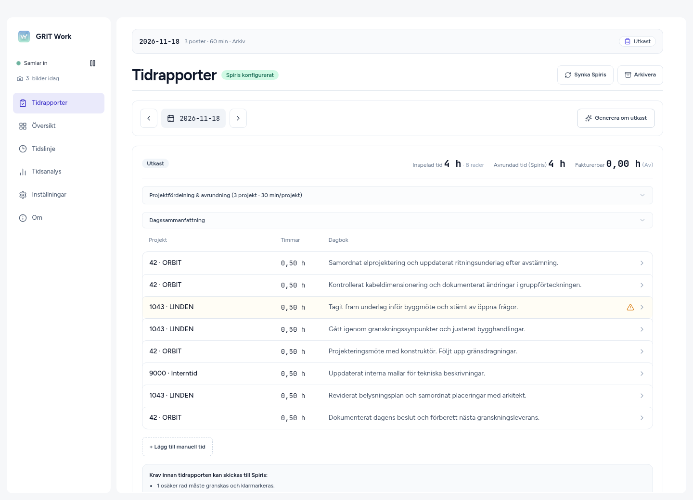

# GRIT Work



GRIT Work är en fork av [Work Review](https://github.com/wm94i/Work-Review) för granskbara tidrapporter i **Spiris Tid**. Appen behåller originalets aktivitetsinsamling och lägger till lokal skärmbildsinsamling med valbart intervall, verifierat dygnsarkiv och rapportutkast via inloggade AI-CLI:er.

Första produktversionen riktar sig enbart till **Windows** och individuella medarbetares rapporter. Installationen aktiverar autostart för aktuell Windows-användare som standard. Fönstret kan stängas medan appen fortsätter i systemfältet; användaren kan pausa eller avsluta.

## Kom igång

1. Starta appen. Introduktionen ber om Spiris-uppgifter och AI-samtycke. Välj uttryckligen **Avvakta** om du vill göra detta senare. Inställningarna finns i vänstermenyn.
2. Ange Spiris app-ID och apphemlighet, eller en befintlig åtkomsttoken. Uppgifterna sparas i Windows Credential Manager.
3. Öppna **Spiris**, synka registret och välj användare. **Testa anslutning** kontrollerar autentisering och läsning utan att registrera tid. Skrivbehörighet kan inte bevisas av ett läsanrop. Aktivitet, tidskod och artikel väljs per rad när rapporten granskas.
4. Välj en skrivbar mapp för långtidslagring. En monterad nätverksdisk fungerar som en vanlig mapp. Appen erbjuder ännu inte direktanslutning till S3 eller annan objektlagring. En molnsynkad lokal mapp bevisar endast att filerna finns i den mappen, inte att molnleverantören har laddat upp dem; använd en faktiskt monterad fjärrlagring om lokal rensning ska bero på fjärrskrivningen.
5. Installera och logga in i vald CLI separat. Förvalda, bildtestade modeller är Codex `gpt-6.2-sol`, Grok `grok-4.7-build-fast` och agy `gemini-4-hydrogen-medium`. Modellnamnet kan ändras. CLI-abonnemangets tillgänglighet och kvot gäller; GRIT behöver ingen AI-API-nyckel.
6. Läs informationen om överföring av bilder och loggar till AI-leverantören och aktivera samtycke. Appen förbereder avslutade dygn i bakgrunden, ett i taget. Färdiga förslag och missade dagar ligger i kön. Granska osäkerheter, komplettera luckor och godkänn sedan hela dagsrapporten före överföring till Spiris. Misslyckade jobb kan startas om manuellt; bakgrundsjobbet skriver aldrig över ett utkast.

Aktivera **Använd min skrivstil från Spiris** om tidigare rapporttexter ska vägleda nya utkast. Appen läser endast vald användares rapporter från de 90 dagarna före rapportdagen. Högst 12 exempeltexter skickas till vald AI-tjänst för ton, längd och detaljnivå, med separat aktivering och AI-samtycke. Historiken räknas aldrig som underlag för nytt arbete. Saknad historik ger vanlig saklig svenska; anslutningsfel kräver ett nytt försök eller att valet stängs av.

**Inspelning måste vara på och datorn vaken.** Paus, låst/ledig dator, integritetsfilter och saknade skärmbehörigheter kan ge luckor. Under **Insamling & lagring** väljer du intervall från 30 sekunder till 60 minuter (standard fem minuter), aktiv skärm eller alla skärmar, JPEG-kvalitet och bildbredd. En skärmbild sparas högst en gång per valt intervall medan insamlingen är aktiv; aktivitetsloggar registrerar även programbyten. Fel i skärminsamlingen pausar inspelningen och visas i appen.

Lagringsuppskattningen visar ett grovt JPEG-spann per dag och 30 dagar utifrån skärmar, intervall, kvalitet och bildstorlek. Loggar tillkommer. Antalet timmar påverkar bara kalkylen. Alla skärmar sparas tillsammans i en bild; större maxbredd kan behövas för läsbar text. På Windows kontrolleras synliga fönster på alla skärmar före och efter fångst. Om en app, webbplats eller känslig titel är undantagen hoppas bilden över. Okänd webbadress när domänundantag finns stoppar också bilden. Kontrollen är konservativ och kan även stoppa bilder för täckta fönster. Bildtagningen återupptas när kontrollen tillåter den; ingen spärrad bild skrivs till disk.

## Ett gemensamt arbetsflöde

Översikt, tidslinje, tidsanalys och tidrapport delar vald arbetsdag, underlag och rapportstatus. Översikten visar också projektfördelningen från den sparade tidrapporten. Registrerad aktivitet och rapporterade minuter är skilda mått; projektfördelning och debiterbarhet granskas i rapporten.

Tidslinjens bilder, timsammanfattningar och JSON-export kan läsa verifierade arkiv efter lokal rensning. Arkiverat underlag är skrivskyddat. Översiktens statistik beräknas med samma databasfrågor för lokalt och arkiverat underlag; arkivdata läses i en tillfällig minnesdatabas. Intervall med arkiverade dagar begränsas till 31 dagar åt gången.

**Tidsanalys** ersätter den generella AI-frågevyn i navigationen. Den använder samma inloggade CLI, modell och underlag som rapportgenereringen, med aktuella integritetsfilter. Svar sparas för vald dag (de senaste 20 frågorna); analysen får aldrig skapa tidsrader eller skicka tid till Spiris. Dagens pågående arbete kan analyseras, men tidrapporten skapas först när dygnet är avslutat. Sparade rapporter kan exporteras till CSV.

Inställningarna har en gemensam tvåkolumnsvy med Allmänt & system, AI & rapportering, Spiris, Insamling & lagring samt Integritet. Gränssnittet använder svenska, ljust Quiet Pro-tema och ISO-datum med måndag som veckans första dag. Regler och hjälptexter nås vid informationsikoner. Den lokala bildmappen kan öppnas direkt från inställningarna.

Dagens rapport visar projekt, timmar och början av dagboken på en kompakt rad. Klick öppnar redigering av text, timmar, projekt och rapporteringsval. Avbryt lämnar raden oförändrad. Slutgranskningen visar tidigare rapporterade rader från samma användare och projekt, och blockerar överföring om det redan finns tid för dagen.

Tid summeras per projekt och kalenderdag och avrundas alltid **uppåt till hela halvtimmar**: 10 + 20 minuter blir 30; 40 blir 60. Registrerad tid och avrundning visas separat. Sista raden per projekt bär avrundningstillägget vid Spiris-överföring, även när projektet har flera aktiviteter. Manuella möten kräver intervall, projekt och förklaring; luckor räknas aldrig automatiskt som arbete.

## Underlag och arkiv

Lokal data ligger alltid i operativsystemets appdata: `%LOCALAPPDATA%\grit-work` på Windows, `$XDG_DATA_HOME/grit-work` (normalt `~/.local/share/grit-work`) på Linux och `~/Library/Application Support/grit-work` på macOS. På Unix begränsas katalogen till ägaren.

Avslutade dygn kontrolleras vid start och varje timme. Arkivet ligger under `<vald mapp>/grit-work/ÅÅÅÅ-MM-DD/` och innehåller bilder, aktivitetsdata med OCR, eventuell rå OCR-dygnslogg och SHA-256-manifest. Källfiler och aktivitetsrader tas bort först efter verifiering. Om arkivet saknas, inte kan skrivas eller är skadat behålls lokalt underlag. Rapporter kan genereras från det verifierade arkivet efter lokal rensning. Rapporter och inställningar behålls lokalt.

Arkivplatsen låses efter första arkiverade dygnet; flytt av befintligt arkiv stöds ännu inte. Använd en egen arkivrot per installation. Automatisk rensning i originalappens gamla storleks-/åldershantering är avstängd.

## Rapporternas skydd

- Agenten får bilder, aktivitetsloggar och projektregister, aldrig Spiris-hemligheten. Underlaget kan innehålla känslig skärminformation och skickas till vald AI-leverantör när användaren startar rapportjobbet.
- Jobben körs med tidsgräns, avbrytning och begränsad svarsstorlek. Dygnet delas i tvåtimmarsintervall och vid behov mindre delar med högst 48 olika bilder, utan att tappa loggar eller bilder. Tätare insamling kan kräva längre tidsgräns för rapportjobbet.
- CLI-inställningar begränsar verktygen. Codex får bilder direkt, Grok måste anropa bildläsaren, agy läser arbetskatalogens bilder. Detta är inte en generell säkerhetsisolering från en komprometterad CLI.
- Backend validerar schemastruktur, verkliga underlagsreferenser, tidsgränser, överlapp och att minuterna ryms inom registrerad tid. Osäkra AI-rader kräver granskning; hela rapporten måste alltid godkännas före överföring.
- Före varje tidsregistrering kontrolleras projektets status, användarens medlemskap samt att vald aktivitet, tidskod och artikel fortfarande är aktiva. Ändrade projektnamn eller nummer kräver ny granskning. Spiris API exponerar inte projektspecifika begränsningslistor för dessa val; appen beskriver denna begränsning och påstår inte att aktiva registerval bevisar alla projektregler.
- Befintlig tid i Spiris för samma användare/dag blockerar överföringen. Den första versionen försöker inte slå ihop manuell tid och GRIT-tid.
- Varje avsikt att skicka sparas före anropet. Vid avbrott eller osäkert svar låses rapporten för avstämning. Inga automatiska omförsök av tidsrader. Delvis överförda rapporter kräver manuell avstämning om alla rader inte kan verifieras.

Originalets översiktsdiagram, aktivitetsgranskning och timsammanfattningar används i det gemensamma GRIT-flödet. Gränssnittet använder en svensk översättningskatalog utan språkval. Automatisk uppdatering är avstängd tills forken har en egen signerad releasekedja.

Arkivets lagringstid är inställbar, 90 dagar som standard. Utgångna dygn rensas först när rapporten är överförd eller dagen uttryckligen hoppats över. Ofärdiga rapporters underlag behålls. Rapporttexter, godkännanden och överföringskvitton raderas inte med underlaget.

## Utveckling och verifiering

Node 22+, Rust och Tauri 2:s plattformsberoenden behövs. Linux kräver WebKitGTK 4.1, GTK 3, Secret Service samt skärm-/fönsterverktyg för aktuell skrivbordsmiljö (på Hyprland bland annat `grim` och `hyprctl`).

```sh
npm ci
npm run verify:frontend
cargo test -p work-review --bin grit-work grit -- --test-threads=1
cargo test -p work-review-core
npm run tauri:build -- --bundles nsis
```

På Arch/Omarchy kan den färdigbyggda binären paketeras med `cd packaging/arch && makepkg`; installera paketet med `sudo pacman -U grit-work-*.pkg.tar.zst`. Det ger appen en post i programstartaren. Debian-paketet hamnar under `target/release/bundle/deb/`.

Kör `node scripts/with-grit-preview.mjs scripts/test-grit-ui.mjs` för webbläsartestet med syntetiskt underlag. `CHROMIUM_PATH` och `GRIT_TEST_URL` kan sättas. Testet kontrollerar att Spiris-anropet inte sker före bekräftelsen och tar bilder i systemets temporärkatalog.

Typsnitten Figtree och JetBrains Mono följer med appen och fungerar utan nätanslutning. `node scripts/with-grit-preview.mjs scripts/export-grit-review.mjs` skapar en tiosidig gransknings-PDF och separata gränssnittsurklipp i `all-artifacts/interface-review/`, enbart med syntetisk testdata.

`node scripts/with-grit-preview.mjs scripts/test-grit-workflow.mjs` verifierar datumöverföring mellan vyer, gemensamma skärmbildsinställningar och att analysen inte anropar den gamla rapportmotorn eller Spiris-överföring.

CLI-bildtestet körs med `cargo run -p work-review --example grit-agent-check -- PROVIDER MODEL IMAGE`, där den syntetiska bilden ska innehålla `SAPPHIRE-729`. Använd Herdr-panel för agentkörningar. `spiris-check` är ett separat läsdiagnostikverktyg som använder nyckellagret; det skickar aldrig tid.

Windows-installationspaket byggs av arbetsflödet `GRIT Work Windows review` och publiceras som granskningsartefakt, inte som signerad release. Lokal Linux-byggmiljö används för enhetstester; detta innebär inte att Linux ingår i första produktversionen. Se [verifieringsstatus](docs/grit/VALIDATION.md) för vad som faktiskt testats. Se [ursprunglig dokumentation](docs/grit/UPSTREAM-README.md) för Work Reviews övriga funktioner. Ursprunglig MIT-licens och upphovsrätt behålls.
